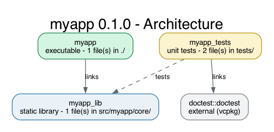

# myapp

One-paragraph description of what this program does.

## Features

- Feature one
- Feature two

## Requirements

- CMake 3.21+
- Ninja
- A C++ compiler (Clang, GCC or MSVC)
- vcpkg with `VCPKG_ROOT` set (the dependencies, currently doctest, are declared in `vcpkg.json` and installed automatically when CMake configures)
- Optional: clang-format and clang-tidy (LLVM), Doxygen, Graphviz

On macOS: `brew install ninja cmake pkg-config llvm doxygen graphviz`

`CMakePresets.json` hands vcpkg to CMake with `"toolchainFile": "$env{VCPKG_ROOT}/scripts/buildsystems/vcpkg.cmake"`, so `VCPKG_ROOT` must point at a bootstrapped vcpkg clone before you configure.

### One-time machine setup

Install vcpkg once per machine, and install Ninja with Homebrew:

```bash
git clone https://github.com/microsoft/vcpkg ~/.vcpkg
~/.vcpkg/bootstrap-vcpkg.sh -disableMetrics
brew install ninja cmake
```

Add this to `~/.zshrc`:

```bash
export VCPKG_ROOT="$HOME/.vcpkg"
export PATH="$VCPKG_ROOT:$PATH"
```

Then open a new terminal, or run `source ~/.zshrc`.

On Windows: clone vcpkg, run `bootstrap-vcpkg.bat`, and set the `VCPKG_ROOT` user environment variable before using the Visual Studio presets.

## Build, run and test

```bash
cmake --preset release && cmake --build --preset release   # optimised build
./build/release/myapp

cmake --preset debug && cmake --build --preset debug       # debug + ASan/UBSan
ctest --preset debug                                        # run unit tests
```

| Preset | What it builds | Output folder |
| --- | --- | --- |
| `release` | Optimised build | `build/release/` |
| `debug` | Debug build with AddressSanitizer and UndefinedBehaviorSanitizer | `build/debug/` |
| `debug-nosan` | Plain debug build, used by the debugger | `build/debug-nosan/` |
| `vs2022` / `vs2026` | Visual Studio solution (Windows only) | `build/vs20xx/` |

## Adding a library

Add the package name to the `dependencies` array in `vcpkg.json`, for example `"fmt"`:

```json
"dependencies": [
  "doctest",
  "fmt"
]
```

In `CMakeLists.txt`, find the package and link it to your library:

```cmake
find_package(fmt CONFIG REQUIRED)
target_link_libraries(myapp_lib PUBLIC fmt::fmt)
```

Re-run `cmake --preset debug`. The first configure downloads and builds the library, which can take a few minutes.

Run `vcpkg search <name>` to find package names. After a package installs, vcpkg prints the exact `find_package` and `target_link_libraries` lines to use.

## Troubleshooting

```text
CMake Error ... Could not find toolchain file:
"/Users/<you>/.vcpkg/scripts/buildsystems/vcpkg.cmake"
CMake was unable to find a build program corresponding to "Ninja".
```

This means vcpkg is not installed at `$VCPKG_ROOT`. The Ninja message is only a side effect of the missing toolchain file. Run the one-time machine setup above, then start from a clean build folder:

```bash
rm -rf build && cmake --preset debug
```

If CMake reports `VCPKG_ROOT is empty`, the `export VCPKG_ROOT=...` line is missing from `~/.zshrc`, or the terminal was opened before you added it. Add the line and open a new terminal.

## Tooling targets

Run these with `cmake --build --preset release --target <name>`:

| Target | Description |
| --- | --- |
| `format` | Format all sources with clang-format |
| `format-check` | Fail if any file is not formatted |
| `tidy` | Run clang-tidy across the project |
| `docs` | Generate Doxygen HTML in `docs/` |
| `class-diagrams` | Generate Graphviz class diagrams into `diagrams/classes/` |
| `diagrams` | Render every `diagrams/*.dot` file to PNG |

## Project structure

```text
.
├── include/myapp/      Public headers, one folder per module
├── src/myapp/          Implementations (built into the myapp_lib library)
├── tests/              doctest unit tests (one file per component)
├── main.cpp            Thin entry point
├── diagrams/           Graphviz sources and rendered PNGs
├── CMakeLists.txt      Build, test and tooling targets
├── CMakePresets.json   release / debug / debug-nosan / Visual Studio presets
├── vcpkg.json          Dependency manifest (installed by vcpkg at configure)
├── Doxyfile.in         Doxygen config (filled in by CMake)
├── Doxyfile.classes.in Doxygen config for the class-diagrams target
├── cmake/              Helper scripts run with `cmake -P`
├── .clang-format       Code style (Allman, 4 spaces)
├── .clang-tidy         Static-analysis checks
├── .clangd             Points clangd at build/compile_commands.json
├── .zed/  .vscode/     Editor tasks and debugger configs
└── .github/workflows/  CI tests, docs to GitHub Pages, release binaries
```

## Architecture



## Releases

Push a version tag to build binaries for Linux, macOS and Windows and attach them to a GitHub Release:

```bash
git tag v0.1.0 && git push origin v0.1.0
```

## Documentation

Pushes to `main` publish the Doxygen site to GitHub Pages. Enable it once under
**Settings → Pages → Build and deployment → Source: GitHub Actions**.

## License

Created by Amr Osman.
