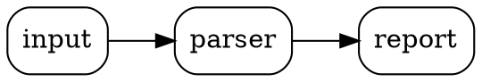

# Documentation

The template turns the comments in your code into a documentation website with
[Doxygen](https://www.doxygen.nl), including diagrams, and publishes it to
GitHub Pages.

## Build it

```bash
cmake --workflow --preset docs     # configure + build in one command
open docs/index.html               # Linux: xdg-open
```

You need Doxygen; with Graphviz installed as well, you also get diagrams.
The site's front page is the project's `README.md`.

## Write documentation comments

Doxygen reads `/** ... */` comments placed just before a declaration:

```cpp
/**
 * @file reader.hpp
 * @brief Reads records from a text stream.
 */

namespace myapp::io
{
    /** @brief Splits a stream into lines. */
    class Reader
    {
    public:
        /**
         * @brief Read every line.
         * @param input Stream to read until its end.
         * @return The lines, without their line breaks.
         * @throws std::ios_base::failure if the stream reports an error.
         */
        std::vector<std::string> ReadLines(std::istream& input) const;

    private:
        bool skipEmptyLines_; ///< Whether empty lines are dropped.
    };
} // namespace myapp::io
```

| Command | Meaning |
| --- | --- |
| `@file` | describes the whole file (put it at the top) |
| `@brief` | the one-line summary shown in lists |
| `@param name` | one per parameter |
| `@return` | what the function returns |
| `@throws Type` | an exception it can throw |
| `@note`, `@warning` | highlighted remarks |
| `///<` | a short comment after a member, on the same line |

Document the **public headers** in `include/` thoroughly: that's what readers
of the site and users of a library see. The build warns about undocumented
public items (`WARN_IF_UNDOCUMENTED`), which is a handy to-do list.

## Diagrams

With Graphviz, the `docs` target first renders into `docs/diagrams/`:

- **`architecture.png`**: the CMake targets (library, app, tests, fuzzers,
  external packages) and how they link. It's drawn from the real build, so it
  never goes stale.
- **`classes/`**: a collaboration diagram per class, with its members and the
  classes it uses.
- **your own diagrams**: put Graphviz `.dot` files in a `diagrams/` folder at
  the project root; each becomes `docs/diagrams/<name>.png`.

A minimal hand-written diagram, `diagrams/data_flow.dot`:



Show a diagram in the README or a doc comment with Doxygen's `\image html data_flow.png`,
or link the published copy at `https://<user>.github.io/<repo>/diagrams/data_flow.png`.

## Publish to GitHub Pages

Every push to `main` builds the site and deploys it (`.github/workflows/docs.yml`).
Turn it on once: **Settings → Pages → Build and deployment → Source: GitHub
Actions**. The site appears at `https://<user>.github.io/<repo>/`.

`docs/` is generated, so it is git-ignored. Never commit it; CI rebuilds it.

## Other places to write things down

- **`README.md`**: what the project is and how to build and use it.
- **`CHANGELOG.md`**: what changed in each version, under `[Unreleased]` until
  a release ([Keep a Changelog](https://keepachangelog.com) format).
- **`SECURITY.md`**: how to report a vulnerability.
